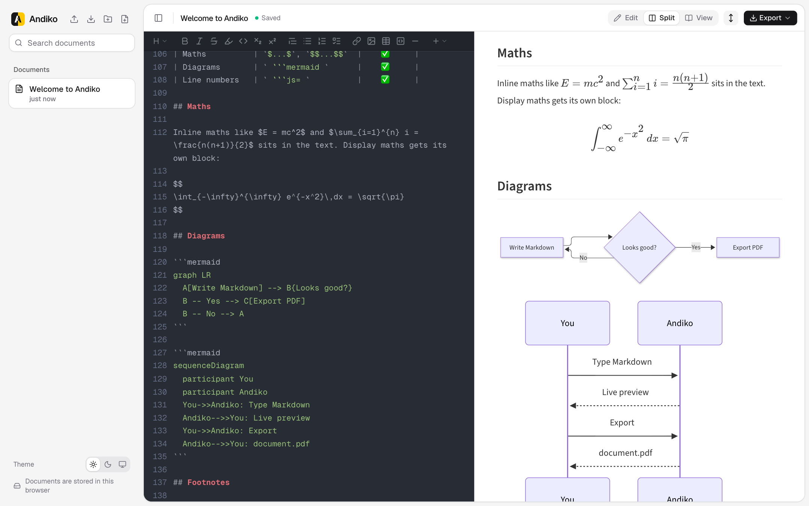

<div align="center">


# Andiko

A free, open-source, local-first Markdown editor with live preview, KaTeX maths, Mermaid diagrams, PDF export and share links. On the web and as a Mac app.

[](https://github.com/musayann/andiko/actions/workflows/ci.yml)
[](https://github.com/musayann/andiko/releases/latest)
[](LICENSE)


[**Try it at andiko.app**](https://andiko.app) · [**Download for macOS**](https://github.com/musayann/andiko/releases/latest) · [Documentation](#documentation) · [Contributing](CONTRIBUTING.md)

</div>

<picture>
  <source media="(prefers-color-scheme: dark)" srcset="apps/web/public/screenshot-dark.png">
  
</picture>

## Features

- **Edit / Split / View**: write on one side and read on the other, or hide either side (<kbd>Ctrl</kbd>+<kbd>Alt</kbd>+<kbd>E</kbd> / <kbd>B</kbd> / <kbd>V</kbd>). Drag the divider to resize. The panes stay scroll-synced.
- **Formatting bar**: buttons above the editor for headings, bold, italic, strikethrough, highlight, inline code, sub/superscript, quotes, lists, task lists, links, images, tables (pick a size from a grid), code blocks and dividers. An Insert menu adds alert boxes, spoilers, math blocks and Mermaid diagrams. Shortcuts: <kbd>Ctrl</kbd>/<kbd>⌘</kbd> + <kbd>B</kbd> bold, <kbd>I</kbd> italic, <kbd>Shift</kbd>+<kbd>X</kbd> strikethrough, <kbd>E</kbd> inline code, <kbd>K</kbd> link.
- **Extended Markdown**:
  - alert boxes (`:::info`, `:::success`, `:::warning`, `:::danger`) and `:::spoiler`
  - `[TOC]`, KaTeX math (`$…$`, `$$…$$`) and Mermaid diagrams
  - code blocks with line numbers (` ```js= `, `=101`, `=+`) and wrapping (`!`)
  - task lists you can click in the preview
  - footnotes, definition lists, abbreviations, `==mark==`, `++ins++`, `~sub~`, `^sup^` and emoji shortcodes
  - YAML front matter (`title`, `tags`, `breaks`)
- **PDF export**: a real download rendered by headless Chrome on the server, with selectable text, embedded fonts and page numbers. Browser printing is available as a fallback.
- **Local-first**: documents live in the browser (IndexedDB), or in the Mac app, in a database on the Mac. Import and download `.md` files. There is no account, and only documents you share are stored on the server.
- **Sharing**: publish a read-only link that follows your edits until you unpublish it. Visitors can save their own editable copy.
- **Folders (optional)**: group documents in nested folders. Move them with the ⋯ menu or by dragging in the sidebar. Documents without a folder stay at the top level.

Built with [Next.js](https://nextjs.org), [shadcn/ui](https://ui.shadcn.com), [CodeMirror](https://codemirror.net), [markdown-it](https://github.com/markdown-it/markdown-it) and, for the Mac app, [Tauri](https://tauri.app).

## Mac app

Download the universal `.dmg` (Apple Silicon and Intel) from the [latest release](https://github.com/musayann/andiko/releases/latest). It is ad-hoc signed, not notarized, so on first launch allow it in System Settings → Privacy & Security → Open Anyway. After that it updates itself. Documents open in tabs and are stored in a SQLite database on your Mac. More in [docs/desktop-app.md](docs/desktop-app.md).

## Quick start

Requires Node 24 (24.22.1 or newer) and pnpm. `.nvmrc` names the version, so `nvm use` picks it up.

```bash
pnpm install        # also downloads Chrome for local PDF export (puppeteer)
pnpm dev            # the website, at http://localhost:3000
```

Configuration is optional: copy `.env.sample` to `.env` at the repo root to enable sharing or change other settings. The first visit seeds a "Welcome" document that shows every supported feature.

See [CONTRIBUTING.md](CONTRIBUTING.md) for the Mac app, the other scripts, and the checks to run before opening a pull request.

## Documentation

- [Self-hosting](docs/self-hosting.md): configuration, Postgres for sharing, privacy policy and terms, Vercel and Docker
- [Mac app](docs/desktop-app.md): storage, tabs, the `andiko://` scheme, releases and auto-updates
- [Architecture](docs/architecture.md): project layout, PDF export pipeline, sharing model and its security
- [Contributing](CONTRIBUTING.md): development setup, scripts and pull request guidelines
- [Security policy](SECURITY.md): how to report a vulnerability

## Contributing

Bug reports, ideas and pull requests are welcome. Read [CONTRIBUTING.md](CONTRIBUTING.md) to get started, look for issues labelled [`good first issue`](https://github.com/musayann/andiko/labels/good%20first%20issue), or ask a question in [Discussions](https://github.com/musayann/andiko/discussions). Everyone taking part is expected to follow the [Code of Conduct](CODE_OF_CONDUCT.md).

## License

Andiko is released under the [MIT License](LICENSE), except for the text of the terms of use in `apps/web/src/app/terms/page.tsx`, which is licensed under [CC BY-SA 4.0](https://creativecommons.org/licenses/by-sa/4.0/).
